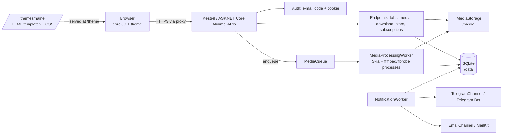

# EventPix: architecture

## 1. Goals and constraints

Private photo/video sharing for a single event, run by a non-expert on a small server.
* .NET 10, SQLite, MIT. Third-party packages must be permissive (MIT / Apache-2.0 / BSD).
* Standalone (Windows/Linux) or Docker. HTTPS and the public web server are the operator's job (IIS/nginx/Caddy).
* Media storage is separate from code and database. Design is separate from logic.

## 2. Components



Single deployable. No external queue, cache or object store. Replace `IMediaStorage` to move blobs to S3 later.

## 3. Hidden link and authentication

* Event URL: `/e/{token}`. Token = 192 random bits, base64url. Only `SHA-256(token)` is used for lookup;
  a Data-Protection-encrypted copy is kept so notification mail can include the link.
  `rotate-token` invalidates a leaked link.
* The link alone shows only the event name and a login box. Content needs a **session**.
* Login: guest enters e-mail -> 6-digit code (HMAC-hashed with a server pepper, 10 min, 5 attempts, 3 codes/10 min)
  -> HttpOnly SameSite=Lax cookie holding `mid` (member) and `eid` (event). `InviteOnly` events accept only
  e-mails on the invite list (owner-managed via `/invites` or `add-invites`) or already-existing members.
* Every `/api/e/{token}/...` request re-resolves the event from the token **and** checks `eid == event.Id`,
  so a session for event A cannot read event B.
* Responses never reveal whether an e-mail is known (always 202).
* Unknown token, unknown media id and foreign-event media id all return 404.

## 4. Data model

```mermaid
erDiagram
  EVENT ||--o{ MEMBER : has
  EVENT ||--o{ INVITE : pre-registers
  EVENT ||--o{ TAB : has
  EVENT ||--o{ MEDIAITEM : has
  EVENT ||--o{ LOGINCODE : issues
  EVENT ||--o{ SUBSCRIPTION : has
  MEMBER ||--o{ MEDIAITEM : uploads
  MEMBER ||--o{ STAR : stars
  MEMBER ||--o{ SUBSCRIPTION : owns
  TAB ||--o{ MEDIAITEM : groups
  MEDIAITEM ||--o{ STAR : starred_by
  TAB }o--o| MEMBER : "owned by (Author tabs)"
  EVENT { guid Id PK  string Name  string TokenHash UK  string TokenProtected  string OwnerEmail  bool InviteOnly  bool UploadsOpen  bool DownloadsOpen }
  MEMBER { guid Id PK  guid EventId FK  string Email  string DisplayName  enum Role }
  INVITE { guid Id PK  guid EventId FK  string Email UK-per-event  datetime CreatedUtc }
  TAB { guid Id PK  guid EventId FK  string Name  enum Kind  int SortOrder  guid OwnerMemberId  bool AllowGuestUploads }
  MEDIAITEM { guid Id PK  guid EventId FK  guid TabId FK  guid UploaderId FK  enum Kind  enum Status  string OriginalFileName  string ContentType  long SizeBytes  string Sha256  string StorageKey  datetime TakenUtc  datetime NotifiedUtc }
  STAR { guid MemberId PK  guid MediaId PK }
  LOGINCODE { guid Id PK  guid EventId FK  string Email  string CodeHash  datetime ExpiresUtc  int Attempts }
  SUBSCRIPTION { guid Id PK  guid EventId FK  guid MemberId FK  enum Channel  string Address  guid TabId  enum Mode  bool Confirmed }
  SUBSCRIPTION ||--o{ OUTBOX : queues
  OUTBOX { long Id PK  guid SubscriptionId FK  enum Channel  string Address  string EventName  string Url  string UnsubscribeUrl  string GroupsJson  datetime NotBeforeUtc  int Attempts  datetime SentUtc }
  EVENT ||--o{ TELEGRAMLINKCODE : issues
  TELEGRAMLINKCODE { guid Id PK  string CodeHash UK  guid EventId FK  guid MemberId FK  guid TabId  enum Mode  datetime ExpiresUtc  datetime ConsumedUtc }
```

Notes
* **Tab.Kind**: `Section` (curated by the owner: "Ceremony", "Party") or `Author` (one per guest, created on first upload).
  Guests upload to their own Author tab by default; to a Section only if `AllowGuestUploads`.
* **Stars are per member** and private; "download starred" uses the caller's stars.
* **Timestamps are UTC `DateTime`** (SQLite cannot order `DateTimeOffset` server-side).
* **Ids are GUID v7** (time-ordered, index friendly). Security never relies on id secrecy; authorisation is always checked.

## 5. Storage layout (outside code and DB)

```
{StoragePath}/{eventId:N}/{mediaId:N}/original      # exact bytes uploaded
                                     /preview.jpg   # <=1920px, EXIF stripped
                                     /thumb.jpg     # <=480px, EXIF stripped
```
Keys are generated by the server; the client file name is metadata only (used for ZIP entry names after sanitising).
`FileSystemMediaStorage.Resolve` rejects rooted or `..` keys. Files are written to a temp name and atomically moved.
Docker: `/media` is a volume; `/data` another. Back up both.
Originals keep their EXIF (including GPS). TODO: owner option to strip location from originals.

## 6. API (all under `/api/e/{token}`)

| Method & path | Auth | Purpose |
|---|---|---|
| GET `/public` | no | Event name/description for the login page |
| POST `/auth/request` `{email}` | no, rate-limited | Send code (always 202) |
| POST `/auth/verify` `{email, code}` | no, rate-limited | Set session cookie |
| POST `/auth/logout` | no | Clear cookie |
| GET `/me`, PUT `/me` | session | Profile |
| GET `/tabs`; POST `/tabs` | session; owner | List (counts, canUpload) / create section |
| PATCH `/tabs/{id}` `{name?, allowGuestUploads?}` | owner | Rename section / toggle guest uploads (author tabs keep the guest's display name) |
| PUT `/tabs/order` `{ids}` | owner | Reorder section tabs (listed order first, then the rest) |
| DELETE `/tabs/{id}` | owner | Remove tab + its media rows + blobs |
| GET `/tabs/{id}/media?skip&take` | session | Page of items (with `starred`) |
| GET/POST/DELETE `/invites` | owner | Invite list for InviteOnly events (add pre-registered e-mails, see who joined) |
| GET `/media/{id}/{thumb\|preview\|original}[?download=true]` | session | Bytes. Original supports HTTP Range for video |
| POST `/uploads[?tab=id]` multipart `files` | session | Upload; default = own tab |
| DELETE `/media/{id}` | uploader or owner | Remove + blobs |
| PUT/DELETE `/media/{id}/star` | session | Star / unstar |
| GET `/download[?tab=id][&starred=true]` | session | Streamed ZIP: file = `/media/..?download`, tab, starred, or everything |
| POST `/download` `{ids}` | session | Streamed ZIP of the selected items (multi-select). Ids of other events are silently dropped; max 500 |
| GET/PUT `/subscriptions`, DELETE `/subscriptions/{id}` | session | Notification settings. PUT accepts `Email` only (confirmed via the sign-in address); `Telegram` answers 400 `telegram_use_link` — link via the bot instead. Deleting a subscription also drops its pending outbox rows (cascade) |
| GET `/subscriptions/telegram-link[?tab=id&mode=x]` | session | Mint a single-use 15-minute code and return `{url}` = `https://t.me/<bot>?start=<code>`; 501 when no bot is configured |
| POST `/api/unsubscribe/{id}/{sig}` | HMAC link | One-click unsubscribe (valid sig is always 204, even if already gone) |
| GET `/u/{id}.{sig}` | HMAC link | Unsubscribe page: theme shell + core JS confirming via the API above |

State-changing calls require header `X-Requested-With: eventpix` (CSRF defence together with SameSite=Lax).

## 7. Pipelines

**Upload**: multipart -> sniff magic bytes (reject unknown/SVG/HTML) -> SHA-256 -> dedupe per tab -> save original
-> row `Processing` -> `MediaQueue` -> worker makes thumb/preview -> `Ready`.
Photos: Skia resizes **after applying the EXIF orientation** (`SKCodec.EncodedOrigin`), so variants are stored upright
and `Width`/`Height` are the displayed dimensions; capture time comes from EXIF `DateTimeOriginal`
(+ `OffsetTimeOriginal`; without an offset the wall time is treated as UTC). JPEG only.
Videos: ffmpeg grabs a frame for the variants; ffprobe fills `DurationSeconds` and `TakenUtc` from the container's
`creation_time`. Missing metadata simply stays null. Unfinished rows are re-queued on start-up.

**ZIP**: query items -> `ZipArchive.CreateAsync` over the response body -> copy each original with `NoCompression`.
No temp files; memory is constant. Entries are `Tab/File.ext`, de-duplicated.

**Notifications**: `NotificationWorker` (every minute) runs two phases.
*Dispatch*: `Ready` items older than the debounce window and not yet dispatched are grouped by (tab, uploader);
one outbox row is enqueued per matching subscription (never to the uploader) and the media is marked dispatched.
`Instant` subscriptions get a row due immediately. `Digest` subscriptions keep a single open row whose
`GroupsJson` accumulates per (tab, uploader) counts; its `NotBeforeUtc` rolls forward by
`EventPix:NotifyDigestHours` (default 24) with every new batch, so delivery is one roll-up message per
window. *Deliver*: due rows are sent through their `INotificationChannel`; failures back off exponentially
(2, 4, 8 … capped at 60 minutes, max 8 attempts) and are then dropped with a warning. Delivery is
at-least-once. Channels only transport a subject + body; `Composer` renders all texts, so a new channel
is one class + one DI line.

**Telegram linking**: the web UI asks `/subscriptions/telegram-link` for a 128-bit single-use code
(stored only as SHA-256, 15-minute TTL). The member opens `t.me/<bot>?start=<code>`; `TelegramUpdateWorker`
long-polls the bot (idle when `Telegram:BotToken` is unset), consumes the code and creates a confirmed
subscription bound to the chat id — the bot proves the chat, like the sign-in code proves the e-mail.
Codes are purged opportunistically; messages never log their contents.

## 8. Theming contract
Core JS has no markup/styling. A theme folder provides:
* `index.html`: shell that loads `/theme/theme.css` and `/app/app.js`, has `<div id="app">`.
* `templates.html`: `<template data-tpl="...">` for `login`, `gallery`, `tab`, `tile`, `lightbox`, `unsubscribe`, `not-found`,
  `subscriptions`, `sub-row`, plus an optional `strings` template holding a JSON object of UI strings (i18n; English fallback).
  Translations are additional `<template data-tpl="strings" data-lang="ru">` variants; the browser language
  picks one (primary-subtag match), and a `?lang=xx` query parameter overrides it.
* `theme.css` and any assets (`/theme/<file>`).

Hooks: `data-ref="..."` marks elements the core fills or wires (see the default theme for the full list).
Theme markup can declare translatable text: `data-i18n="key"` sets `textContent` from the strings system
and `data-i18n-aria="key"` sets the `aria-label`; keep them on leaf elements. The core fills both on every
rendered view, so a theme is localisable purely through its `strings` templates.
Gallery hooks beyond the basics: `select` (toggle multi-select), `download-selected` (POSTs `/download`),
`progress` (upload bar), `sentinel` (infinite-scroll marker; without it only the first page loads),
`subscribe` (opens the notifications dialog).
The `unsubscribe` template needs `data-ref="title"` and `data-ref="message"`; the core confirms the unsubscribe
by POSTing to `/api/unsubscribe/{id}/{sig}` and writes the outcome via `textContent`.
The `subscriptions` dialog needs `data-ref="title|close|list|empty|form|channel|tab|mode|message"`; each
`sub-row` needs `data-ref="label|remove"`. The core lists current subscriptions, saves e-mail ones via
`PUT /subscriptions`, mints the deep link via `GET /subscriptions/telegram-link` for Telegram, and deletes
via `DELETE /subscriptions/{id}`.

State is exposed to CSS as attributes and properties — the core never sets classes for looks:
* every rendered view carries `data-tpl="<name>"`;
* gallery shell: `data-uploading=true|false`, `data-selecting=true|false`, progress element gets `--progress: 0-100%`;
* tiles: `data-kind`, `data-starred`, `data-selected`, `aria-selected` on tabs, `--ratio` on tiles;
* lightbox: `data-starred`, `data-zoom=true` while zoomed; grid: `data-complete=true` when no more pages.

i18n keys (strings template): `rateLimited`, `emailInvalid`, `codeInvalid`, `eyebrow`, `emailLabel`, `sendCode`,
`codeLabel`, `viewAlbum`, `upload`, `notifyMe`, `signout`, `downloadTab`, `downloadStarred`, `downloadAll`,
`empty`, `notFoundTitle`, `notFoundText`, `uploading` (`{percent}`), `uploaded` (`{count}`), `uploadFailed`
(`{name}`), `subsTitle`, `subsChannel`, `subsEmail`, `subsTelegram`, `subsTab`, `subsAllTabs`, `subsMode`,
`subsInstant`, `subsDigest`, `subsAdd`, `subsEmpty`, `subsRemove`, `subsFail`, `subsTelegramHint`,
`subsTelegramOff`, `select`, `selecting`, `downloadSelected` (`{count}`), `downloadFailed`, `unsubTitle`,
`unsubOk`, `unsubInvalid`, `unsubBadLink`, and the `aria*` labels (`ariaOpen`, `ariaStar`, `ariaClose`,
`ariaPrev`, `ariaNext`, `ariaFullscreen`, `ariaDownload`).

The core only writes text via `textContent`. CSP forbids inline script/style and remote hosts, so ship fonts and images inside the theme folder.
Themes are validated by name (`^[A-Za-z0-9_-]+$`) and served read-only.

## 9. Security checklist

* [x] Unguessable event URL, hashed in DB, rotatable
* [x] Passwordless OTP: HMAC-hashed, expiring, attempt- and rate-limited, no account enumeration
* [x] Cookie: HttpOnly, SameSite=Lax, Secure when proxy forwards https; per-event claim check
* [x] CSRF header, strict CSP, `no-referrer`, `noindex`, `nosniff`, `frame-ancestors 'none'`
* [x] Uploads: size limit, content sniffing, whitelist types, no SVG/HTML, server-generated paths, pixel-count guard
* [x] Telegram link codes: 128-bit single-use, 15-minute TTL, stored only as SHA-256; bot-confirmed chat ids
* [x] Media served only through authorised endpoints, never from a static path
* [x] ffmpeg via `ArgumentList` (no shell), timeout
* [x] Log level for `Hosting.Diagnostics` lowered so tokens in URLs are not logged at Information
* [x] Container: non-root, read-only rootfs, `cap_drop: ALL`, port bound to localhost
* [x] EF migrations (`MigrateAsync` at startup); machine-generated `Migrations/` code is exempt from the analyzer contract via its scoped `.editorconfig`
* [ ] TODO: antivirus hook interface; per-event storage quota; audit log; Dependabot + `dotnet list package --vulnerable` in CI

Operator notes: proxy must set `X-Forwarded-Proto`; set `EventPix:TrustForwardedHeaders=true` only if the app port is not publicly reachable;
set client body-size and timeouts in nginx/IIS (`client_max_body_size`, `maxAllowedContentLength`).

## 10. Key decisions

| Decision | Why |
|---|---|
| Minimal APIs + vanilla JS, no SPA framework or build step | Contributors can theme with only HTML/CSS; no Node toolchain |
| CLI for event admin | No admin UI to secure in v1 |
| SQLite + filesystem | Zero-ops; the target is one event on one box |
| SkiaSharp (MIT) not ImageSharp | Licence compatibility with a permissive project |
| Lightbox zoom is native (pointer-events pinch + wheel + double click), not a vendored PhotoSwipe | Zero third-party JS; the theming contract stays in the theme; CSP trivially clean |
| ffmpeg as external process | LGPL/GPL stays outside the binary |
| One cookie, one event at a time | Simplicity. Opening a second event signs you into that one |
| Strict analysis baked into `Directory.Build.props` | All CA rules on (`AnalysisLevel latest-all`), code style + naming enforced in build, warnings are errors, NuGet audit down to low severity. Style/naming contract lives in `.editorconfig`; `dotnet format EventPix.slnx --verify-no-changes` is the CI gate |
| App types are `internal` | CA1515: this is an application, not a library. Tests see internals via `InternalsVisibleTo` |
| Single NuGet source in `NuGet.config` | Central Package Management needs deterministic restore (NU1507); patched direct refs pin vulnerable transitives (SQLitePCLRaw, System.Security.Cryptography.Pkcs) |

## 11. Testing layers

* **Unit** (xUnit): security-relevant helpers — tokens, OTP parsing, sniffing, storage key resolution, EXIF/ffprobe parsing, image orientation matrices.
* **Integration** (xUnit + `WebApplicationFactory` + TestServer): endpoints, auth flows, invite gating, tab/invite management, unsubscribe API, upload -> media-worker pipeline, all against a temp SQLite DB and storage dir.
* **E2E** (`Microsoft.Playwright`, MIT, test-only): the real app as a Kestrel process on a random loopback port (temp paths via `EventPix__*` env vars), driven by Chromium through the theme's `data-ref` hooks — login, upload, lightbox, star, ZIP download, unsubscribe page. Selectors never use styling classes, so the suite doubles as a theming-contract check. Chromium is downloaded on first use (cached per machine); no Node tooling enters the repo or the shipped app.

Local quality gate: `pwsh scripts/sonar-local.ps1` runs the same SonarCloud analysis as CI (needs `SONAR_TOKEN`; the gate result shows on sonarcloud.io a few minutes after the run). The quick no-upload approximation is `dotnet build` + `dotnet format EventPix.slnx --verify-no-changes` — it covers the C# analyzers but not the JavaScript rules.

## 12. Open questions

1. HEIC/HEIF from iPhones: convert server-side (needs libheif; check licence) or ask guests to upload JPEG?
2. Video: transcode to a web-friendly H.264 preview? (CPU heavy; make it optional.)
3. ~~Telegram linking UX~~ — decided: deep link `t.me/bot?start=<code>` minted by the web UI (M3).
4. Owner admin web UI (tabs, members, moderation) vs. staying CLI-only.
