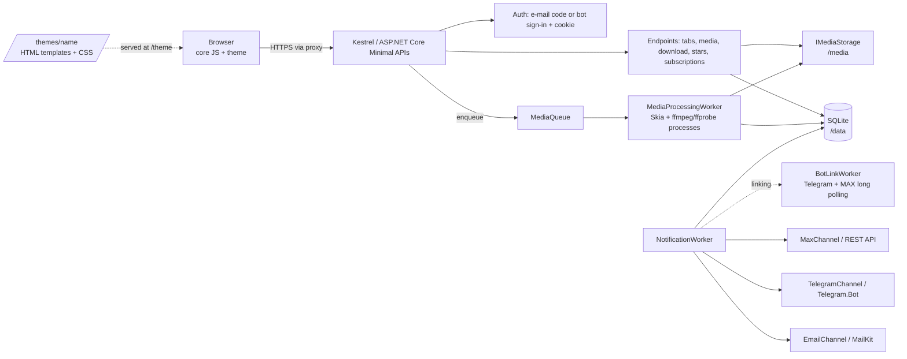

# EventPix: architecture

## 1. Goals and constraints

Private photo/video sharing for a single event, run by a non-expert on a small server.
* .NET 10, SQLite, MIT. Third-party packages must be permissive (MIT / Apache-2.0 / BSD).
* Standalone (Windows/Linux) or Docker. HTTPS and the public web server are the operator's job (IIS/nginx/Caddy).
* Media storage is separate from code and database. Design is separate from logic.

## 2. Components



Single deployable. No external queue, cache or object store. Replace `IMediaStorage` to move blobs to S3 later.

## 3. Hidden link and authentication

* Event URL: `/e/{token}`. Token = 192 random bits, base64url. Only `SHA-256(token)` is used for lookup;
  a Data-Protection-encrypted copy is kept so notification mail can include the link.
  `rotate-token` invalidates a leaked link.
* **Guest viewing**: on events that are not `InviteOnly`, the link alone browses the album read-only —
  tabs, media (including inline video) and downloads (unless `DownloadsOpen` is off). Uploading, starring,
  notifications and every management action still need a **session**. `InviteOnly` events keep the login
  wall for viewing too, or the invite gate would mean nothing.
* Login: guest enters e-mail -> 6-digit code (HMAC-hashed with a server pepper, 10 min, 5 attempts, 3 codes/10 min)
  -> HttpOnly SameSite=Lax cookie holding `mid` (member) and `eid` (event). `InviteOnly` events accept only
  e-mails on the invite list (owner-managed via `/invites` or `add-invites`) or already-existing members.
* **Bot sign-in (Telegram/MAX)**: an alternative passwordless login with no e-mail or SMS. The browser mints a
  128-bit single-use `LoginRequest` (stored only as SHA-256, 15-minute TTL) and shows the bot's deep link; the
  member presses Start in the chat; `BotLinkWorker` proves the sender's messenger identity (channel + stable
  user id) and marks the request confirmed; the polling browser consumes it atomically and receives the same
  session cookie. Open events join like any e-mail could; `InviteOnly` events require a pre-registered
  messenger invite (handle, owner-managed like e-mails). Messenger members carry `MessengerChannel` +
  `MessengerId` (and the handle seen at sign-in) — uploads/stars attribute to that identity. The same person
  signing in via e-mail **and** a messenger is deliberately two members; the event owner always stays the
  e-mail identity, bot sign-ins are always `Guest`.
* Every `/api/e/{token}/...` request re-resolves the event from the token **and** checks `eid == event.Id`,
  so a session for event A cannot read event B.
* Responses never reveal whether an e-mail is known (always 202), and the bot-login poll answers the same
  uniform `pending` for unknown, expired, unconfirmed and already-consumed codes.
* Unknown token, unknown media id and foreign-event media id all return 404.

## 4. Data model

```mermaid
erDiagram
  EVENT ||--o{ MEMBER : has
  EVENT ||--o{ INVITE : pre-registers
  EVENT ||--o{ TAB : has
  EVENT ||--o{ MEDIAITEM : has
  EVENT ||--o{ LOGINCODE : issues
  EVENT ||--o{ SUBSCRIPTION : has
  MEMBER ||--o{ MEDIAITEM : uploads
  MEMBER ||--o{ STAR : stars
  MEMBER ||--o{ SUBSCRIPTION : owns
  TAB ||--o{ MEDIAITEM : groups
  MEDIAITEM ||--o{ STAR : starred_by
  TAB }o--o| MEMBER : "owned by (Author tabs)"
  EVENT { guid Id PK  string Name  string TokenHash UK  string TokenProtected  string OwnerEmail  bool InviteOnly  bool UploadsOpen  bool DownloadsOpen }
  MEMBER { guid Id PK  guid EventId FK  string Email UK-per-event  enum MessengerChannel  string MessengerId UK-per-event  string MessengerHandle  string DisplayName  enum Role }
  INVITE { guid Id PK  guid EventId FK  string Email UK-per-event  enum MessengerChannel  string MessengerHandle UK-per-event  datetime CreatedUtc }
  TAB { guid Id PK  guid EventId FK  string Name  enum Kind  int SortOrder  guid OwnerMemberId  bool AllowGuestUploads }
  MEDIAITEM { guid Id PK  guid EventId FK  guid TabId FK  guid UploaderId FK  enum Kind  enum Status  string OriginalFileName  string ContentType  long SizeBytes  string Sha256  string StorageKey  datetime TakenUtc  datetime NotifiedUtc }
  STAR { guid MemberId PK  guid MediaId PK }
  LOGINCODE { guid Id PK  guid EventId FK  string Email  string CodeHash  datetime ExpiresUtc  int Attempts }
  SUBSCRIPTION { guid Id PK  guid EventId FK  guid MemberId FK  enum Channel  string Address  guid TabId  enum Mode  bool Confirmed }
  SUBSCRIPTION ||--o{ OUTBOX : queues
  OUTBOX { long Id PK  guid SubscriptionId FK  enum Channel  string Address  string EventName  string Url  string UnsubscribeUrl  string GroupsJson  datetime NotBeforeUtc  int Attempts  datetime SentUtc }
  EVENT ||--o{ BOTLINKCODE : issues
  BOTLINKCODE { guid Id PK  enum Channel  string CodeHash UK  guid EventId FK  guid MemberId FK  guid TabId  enum Mode  datetime ExpiresUtc  datetime ConsumedUtc }
  EVENT ||--o{ LOGINREQUEST : issues
  LOGINREQUEST { guid Id PK  enum Channel  string CodeHash UK  guid EventId FK  guid MemberId FK  datetime ExpiresUtc  datetime ConsumedUtc }
```

Notes
* **Member identity is one of two kinds**: an e-mail (Email set) or a messenger identity
  (MessengerChannel + MessengerId set, MessengerHandle informational). Uniqueness is per event per kind;
  the same person may exist as several members (one per sign-in method) by design.
* **Tab.Kind**: `Section` (curated by the owner: "Ceremony", "Party") or `Author` (personal tabs). Every member
  gets one Author tab automatically on their first upload (named after their display name), and can create any
  number of named Author tabs from the UI. A member's Author tab names are unique (DB-enforced). Only the tab's
  owner and the event owner may upload to an Author tab; Sections accept guest uploads only if `AllowGuestUploads`.
* **Stars are per member** and private; "download starred" uses the caller's stars.
* **Timestamps are UTC `DateTime`** (SQLite cannot order `DateTimeOffset` server-side).
* **Ids are GUID v7** (time-ordered, index friendly). Security never relies on id secrecy; authorisation is always checked.

## 5. Storage layout (outside code and DB)

```
{StoragePath}/{eventId:N}/{mediaId:N}/original      # exact bytes uploaded
                                     /preview.jpg   # <=1920px, EXIF stripped
                                     /thumb.jpg     # <=480px, EXIF stripped
```
Keys are generated by the server; the client file name is metadata only (used for ZIP entry names after sanitising).
`FileSystemMediaStorage.Resolve` rejects rooted or `..` keys. Files are written to a temp name and atomically moved.
Docker: `/media` is a volume; `/data` another. Back up both.
Originals keep their EXIF (including GPS). TODO: owner option to strip location from originals.

## 6. API (all under `/api/e/{token}`)

| Method & path | Auth | Purpose |
|---|---|---|
| GET `/public` | no | Event name/description for the login page, plus server capabilities: `telegram` / `max` are `true` only when that bot token is configured (the UI hides the channel otherwise) |
| POST `/auth/request` `{email}` | no, rate-limited | Send code (always 202) |
| POST `/auth/verify` `{email, code}` | no, rate-limited | Set session cookie |
| POST `/auth/logout` | no | Clear cookie |
| POST `/auth/bot/request` `{channel: Telegram\|Max}` | no, rate-limited | Mint a single-use 15-minute sign-in code; returns `{url}` = the bot's deep link, `expiresUtc`; 501 `bot_not_configured`, 400 `unknown_channel` |
| POST `/auth/bot/poll` `{code}` | no, rate-limited | Uniform `{status:"pending"}` until the chat confirmed the request; then consumes it atomically and sets the session cookie (204) |
| GET `/me`, PUT `/me` | session | Profile |
| GET `/tabs`; POST `/tabs` | session or guest; POST: session | List (counts, canUpload, canRename; guests get all-false) / create tab: `personal:true` (or any non-owner) creates a named Author tab owned by the caller; owners may omit it to create a Section. Duplicate Author tab name -> 409 `name_in_use` |
| PATCH `/tabs/{id}` `{name?, allowGuestUploads?}` | owner or tab owner | Rename any tab; only owners toggle Section guest uploads. Duplicate Author tab name -> 409 `name_in_use` |
| PUT `/tabs/order` `{ids}` | owner | Reorder section tabs (listed order first, then the rest) |
| DELETE `/tabs/{id}` | owner or tab owner | Remove tab + its media rows + blobs (members: own Author tabs only) |
| GET `/tabs/{id}/media?skip&take` | session or guest | Page of items (with `starred`, `canDelete` = uploader or owner; guests always false) |
| GET/POST/DELETE `/invites` | owner | Invite list for InviteOnly events. POST takes `{email}` or `{channel: Telegram\|Max, handle}` (handle normalised: lower-case, no @); GET reports `joined` for both kinds |
| GET `/media/{id}/{thumb\|preview\|original}[?download=true]` | session or guest | Bytes. Original supports HTTP Range for video |
| POST `/uploads[?tab=id]` multipart `files` | session | Upload; default = own tab |
| DELETE `/media/{id}` | uploader or owner | Remove + blobs |
| PUT/DELETE `/media/{id}/star` | session | Star / unstar |
| GET `/download[?tab=id][&starred=true]` | session or guest (starred needs a session) | Streamed ZIP: file = `/media/..?download`, tab, starred, or everything |
| POST `/download` `{ids}` | session or guest | Streamed ZIP of the selected items (multi-select). Ids of other events are silently dropped; max 500 |
| GET/PUT `/subscriptions`, DELETE `/subscriptions/{id}` | session | Notification settings. PUT accepts `Email` only (confirmed via the sign-in address; bot sign-ins have none and get 400 `email_unavailable`); bot channels answer 400 `bot_use_link` — link via the bot instead. Deleting a subscription also drops its pending outbox rows (cascade) |
| GET `/subscriptions/bot-link?channel=Telegram\|Max[&tab=id&mode=x]` | session | Mint a single-use 15-minute code and return `{url}` = the bot's deep link with the code as payload (`https://t.me/...` or `https://max.ru/...`); 501 `bot_not_configured` when that bot is unset, 400 `unknown_channel` for non-bot channels |
| POST `/api/unsubscribe/{id}/{sig}` | HMAC link | One-click unsubscribe (valid sig is always 204, even if already gone) |
| GET `/u/{id}.{sig}` | HMAC link | Unsubscribe page: theme shell + core JS confirming via the API above |

State-changing calls require header `X-Requested-With: eventpix` (CSRF defence together with SameSite=Lax).

Outside the event scope: `GET /healthz` - process liveness plus database readiness. Returns a status word only; no event, member or storage details.

## 7. Pipelines

**Upload**: multipart -> sniff magic bytes (reject unknown/SVG/HTML) -> SHA-256 -> dedupe per tab -> per-event quota
check (`EventPix:EventQuotaBytes`, 0 = unlimited) -> antivirus hook (`IAntivirusScanner`; no-op by default, fail-closed:
any scanner error rejects the file) -> save original
-> row `Processing` -> `MediaQueue` -> worker makes thumb/preview -> `Ready`.
Photos: Skia resizes **after applying the EXIF orientation** (`SKCodec.EncodedOrigin`), so variants are stored upright
and `Width`/`Height` are the displayed dimensions; capture time comes from EXIF `DateTimeOriginal`
(+ `OffsetTimeOriginal`; without an offset the wall time is treated as UTC). JPEG only.
Videos: ffmpeg grabs a frame for the variants; ffprobe fills `DurationSeconds` and `TakenUtc` from the container's
`creation_time`. Missing metadata simply stays null. Unfinished rows are re-queued on start-up.

**ZIP**: query items -> `ZipArchive.CreateAsync` over the response body -> copy each original with `NoCompression`.
No temp files; memory is constant. Entries are `Tab/File.ext`, de-duplicated.

**Notifications**: `NotificationWorker` (every minute) runs two phases.
*Dispatch*: `Ready` items older than the debounce window and not yet dispatched are grouped by (tab, uploader);
one outbox row is enqueued per matching subscription (never to the uploader) and the media is marked dispatched.
`Instant` subscriptions get a row due immediately. `Digest` subscriptions keep a single open row whose
`GroupsJson` accumulates per (tab, uploader) counts; its `NotBeforeUtc` rolls forward by
`EventPix:NotifyDigestHours` (default 24) with every new batch, so delivery is one roll-up message per
window. *Deliver*: due rows are sent through their `INotificationChannel`; failures back off exponentially
(2, 4, 8 … capped at 60 minutes, max 8 attempts) and are then dropped with a warning. Delivery is
at-least-once. Channels only transport a subject + body; `Composer` renders all texts (from the
`Localization/Messages` catalogue, see below), so a new channel is one class + one DI line.

**Server-side languages**: every text the server composes itself — the OTP e-mail, notification
messages and bot replies — comes from the `Localization/Messages` catalogue and follows
`EventPix:Language` (`en` default, `ru` shipped; unknown tags fall back to English). The setting is
deployment-wide because e-mail and bot chats carry no language signal; the browser side is
per-visitor through the theme's `strings` templates instead. English strings must stay
byte-identical to the historical texts (tests assert them).

**Bot linking (Telegram and MAX)**: the web UI asks `/subscriptions/bot-link?channel=…` for a 128-bit
single-use code (stored only as SHA-256, 15-minute TTL, together with its channel). The member opens the
bot's deep link (`t.me/<bot>?start=<code>` or `max.ru/<bot>?start=<code>`); `BotLinkWorker` long-polls each
configured bot (idle when its `Telegram:BotToken` / `Max:BotToken` is unset), consumes the code for its own
channel only and creates a confirmed subscription bound to the chat id - the bot proves the chat, like the
sign-in code proves the e-mail. Codes are purged opportunistically; messages never log their contents.
**Bot sign-in** rides the same seam: `/auth/bot/request` mints a `LoginRequest` (same code shape and TTL),
the worker resolves the sender's messenger identity on `/start` (existing member reused; otherwise created
on open events, or matched against a messenger invite on `InviteOnly` ones) and marks the request confirmed;
the polling browser consumes it (`ConsumedUtc` set by an atomic `ExecuteUpdate`, so exactly one poll wins)
and gets the session. Gateways normalise both platforms into one `BotMessage(chatId, senderId, name,
username, text)`; MAX is a plain REST client over `platform-api2.max.ru` (raw token in the `Authorization`
header): `GET /me` for the bot username, `POST /messages?chat_id=…` for delivery, `GET /updates` long
polling for `bot_started` (deep-link payload + `user`) and `message_created` (`/start <code>` + `sender`)
updates.

## 8. Theming contract
Core JS has no markup/styling. A theme folder provides:
* `index.html`: shell that loads `/theme/theme.css` and `/app/app.js`, has `<div id="app">`, and links the
  app-wide favicon `/favicon.png` (a brand asset served from `wwwroot`, shared by all themes).
* `templates.html`: `<template data-tpl="...">` for `login`, `gallery`, `tab`, `tile`, `lightbox`, `unsubscribe`, `not-found`,
  `subscriptions`, `sub-row`, `tab-editor`, `tab-manage`, `tab-manage-row`, `invites`, `invite-row`,
  plus an optional `strings` template holding a JSON object of UI strings (i18n; English fallback).
  Translations are additional `<template data-tpl="strings" data-lang="ru">` variants; the browser language
  picks one (primary-subtag match), and a `?lang=xx` query parameter overrides it.
* `theme.css` and any assets (`/theme/<file>`).

Hooks: `data-ref="..."` marks elements the core fills or wires (see the default theme for the full list).
The `login` template carries, besides the e-mail/code forms, `data-ref="bot-login"` (unhidden when `/public`
reports a configured bot), the per-channel buttons `data-ref="login-telegram"` / `data-ref="login-max"`
(hidden unless that capability is true), `data-ref="bot-open"` (the deep-link anchor shown after minting)
and `data-ref="login-status"` (a `role="status"` live region the core fills with in-progress feedback -
connecting/sending/checking - plus the waiting/expired text). The core polls `/auth/bot/poll` every 3 seconds until
confirmation, expiry or the visitor leaving the login screen.
Theme markup can declare translatable text: `data-i18n="key"` sets `textContent` from the strings system
and `data-i18n-aria="key"` sets the `aria-label` and mirrors it to a `title` hover hint (so icon-only
buttons get tooltips for free); keep them on leaf elements. The core fills both on every
rendered view, so a theme is localisable purely through its `strings` templates. After the strings
load the core also sets `document.title` from the `pageTitle` key (the static `<title>` in
`index.html` is only the pre-JS fallback), so themes localise the tab title through the same system.
Gallery hooks beyond the basics: `select` (toggle multi-select), `download-selected` (POSTs `/download`),
`progress` (upload bar), `dropzone-text` (text of the theme's drag-and-drop overlay, filled during a file
drag; the overlay itself is theme markup shown via the `[data-dragover]` state below — drops are accepted
only from signed-in members and only while the current tab accepts their uploads, mirroring `POST /uploads`),
`sentinel` (infinite-scroll marker; without it only the first page loads),
`subscribe` (opens the notifications dialog), `tab-add` (opens the new-tab dialog), `tab-rename`
(opens the rename dialog; hidden unless the selected tab is renameable by the caller), and the owner-only
`manage-tabs` (tab administration dialog) and `invites` (invite management dialog) — both hidden unless
`GET /me` reports `isOwner`.
The `tab-editor` dialog needs `data-ref="title|close|form|name|message|delete"`; it creates personal tabs
via `POST /tabs {name, personal:true}`, renames via `PATCH /tabs/{id}`, and — for tabs the caller may
delete (own, or any as owner) — deletes via `DELETE /tabs/{id}` behind a two-step armed `delete` button.
The `tab-manage` dialog needs `data-ref="close|list|form|name|message"`; it adds section tabs
(`POST /tabs {name}` as owner), and each `tab-manage-row` needs `data-ref="label|guests|up|down|delete"`:
the checkbox PATCHes `allowGuestUploads` (sections only), the arrows reorder sections via `PUT /tabs/order`,
and the armed `delete` removes the tab with all its media. The `invites` dialog needs
`data-ref="close|list|empty|form|email|message"`; each `invite-row` needs `data-ref="label|state|remove"` —
the core lists, adds and deletes invites (owner only). The invite input takes an e-mail or a messenger
invite in the `telegram:@user` / `max:@user` form; rows label messenger invites with their @handle.
Tiles expose an optional `delete` hook (owner or uploader; per-item `canDelete` from the media listing):
first click arms it, second deletes via `DELETE /media/{id}`; the lightbox offers the same armed `delete` —
its button carries a theme-drawn glyph (e.g. a trash icon) plus a `data-ref="delete-label"` span that the
core fills with the armed hint text and un-hides while armed, leaving the glyph itself untouched.
The `unsubscribe` template needs `data-ref="title"` and `data-ref="message"`; the core confirms the unsubscribe
by POSTing to `/api/unsubscribe/{id}/{sig}` and writes the outcome via `textContent`.
The `subscriptions` dialog needs `data-ref="title|close|list|empty|form|channel|tab|mode|message"`; each
`sub-row` needs `data-ref="label|remove"`. The core lists current subscriptions, saves e-mail ones via
`PUT /subscriptions`, mints the deep link via `GET /subscriptions/bot-link?channel=…` for bot channels
(hiding those the server's `/public` capabilities marked unconfigured), and deletes
via `DELETE /subscriptions/{id}`.

State is exposed to CSS as attributes and properties — the core never sets classes for looks:
* every rendered view carries `data-tpl="<name>"`;
* gallery shell: `data-uploading=true|false`, `data-selecting=true|false`, progress element gets `--progress: 0-100%`,
  `data-dragover=true` while a file drag hovers the gallery (removed otherwise) and `data-dropallowed=true|false`
  for whether the drop would be accepted (drives the overlay's allowed/blocked look);
* tiles: `data-kind`, `data-starred`, `data-selected`, `data-candelete`, `data-armed` while the delete is armed,
  `aria-selected` on tabs, `--ratio` on tiles;
* lightbox: `data-starred`, `data-armed`, `data-zoom=true` while zoomed; grid: `data-complete=true` when no more pages;
  the core pans and pinch/scroll-zooms the media element itself (it is created non-draggable), so the theme's stage
  must size its media area with definite tracks (e.g. `grid-template: minmax(0,1fr) / minmax(0,1fr)`) — auto tracks
  size to the media and its `max-width`/`max-height: 100%` would never constrain it — and should keep
  `touch-action: none` on the stage;
* manage rows: `data-kind` (`section|author`), `data-armed` while the delete is armed;
* busy feedback: forms and buttons carry `data-busy=true` while their request is in flight (e-mail code
  request, code verify, bot sign-in request, dialog saves/deletes, selection ZIP download) and the core
  ignores re-entry while busy, so a double click cannot fire a request twice; themes dim
  `[data-busy=true]` controls (the login status text renders into `login-status` above).

i18n keys (strings template): `pageTitle`, `rateLimited`, `emailInvalid`, `codeInvalid`, `eyebrow`, `emailLabel`, `sendCode`, `sendingCode`,
`codeLabel`, `verifyingCode`, `viewAlbum`, `loginTelegram`, `loginMax`, `botOpenTelegram`, `botOpenMax`, `botConnecting`, `botWaiting`, `botExpired`,
`botFail`, `upload`, `notifyMe`, `signout`, `back`, `downloadTab`, `downloadStarred`, `downloadAll`,
`empty`, `notFoundTitle`, `notFoundText`, `uploading` (`{percent}`), `uploaded` (`{count}`), `uploadFailed`
(`{name}`), `dropHere`, `dropSignIn`, `dropNotAllowed`, `subsTitle`, `subsChannel`, `subsEmail`, `subsTelegram`, `subsMax`, `subsTab`, `subsAllTabs`, `subsMode`,
`subsInstant`, `subsDigest`, `subsAdd`, `subsEmpty`, `subsRemove`, `subsFail`, `subsTelegramHint`,
`subsTelegramOff`, `subsMaxHint`, `subsMaxOff`, `select`, `selecting`, `downloadSelected` (`{count}`), `downloadPreparing`, `downloadFailed`, `unsubTitle`,
`unsubOk`, `unsubInvalid`, `unsubBadLink`, `tabNew`, `tabRename`, `tabCreateTitle`, `tabRenameTitle`,
`tabNameLabel`, `tabSave`, `tabDelete`, `tabDeleteArmed`, `tabNameInUse`, `tabFail`, `manageTabs`,
`manageTitle`, `addSection`, `guestUploads`, `invites`, `invitesTitle`, `invitesEmailLabel`, `invitesAdd`,
`invitesEmpty`, `invitesJoined`, `invitesPending`, `inviteFail`, `mediaDeleteArmed`, and the `aria*`
labels (`ariaOpen`, `ariaStar`, `ariaClose`, `ariaPrev`, `ariaNext`, `ariaFullscreen`, `ariaDownload`,
`ariaRename`, `ariaDelete`, `ariaUp`, `ariaDown`).

The core only writes text via `textContent`. CSP forbids inline script/style and remote hosts, so ship fonts and images inside the theme folder.
Themes are validated by name (`^[A-Za-z0-9_-]+$`) and served read-only.
`themes/default` and `themes/mono` (dark, editorial) ship in the repo; `mono` exists to prove the contract -
completely different markup, class names and CSS over the same hooks, switched with one setting.
`themes/wedding` (bright & sweet: cream/blush palette, serif italic headings, light-only) is a second
worked example with its own markup and class names.
`ThemingTests` enforces that every theme serves the shell, all templates and every `data-ref` the core JS uses.

## 9. Security checklist

* [x] Unguessable event URL, hashed in DB, rotatable
* [x] Passwordless OTP: HMAC-hashed, expiring, attempt- and rate-limited, no account enumeration
* [x] Cookie: HttpOnly, SameSite=Lax, Secure when proxy forwards https; per-event claim check
* [x] CSRF header, strict CSP, `no-referrer`, `noindex`, `nosniff`, `frame-ancestors 'none'`
* [x] Uploads: size limit, content sniffing, whitelist types, no SVG/HTML, server-generated paths, pixel-count guard
* [x] Bot link codes: 128-bit single-use, 15-minute TTL, stored only as SHA-256, scoped to their channel; bot-confirmed chat ids
* [x] Bot sign-in: same code hygiene; uniform `pending` poll (no existence leaks); the confirmation is
      consumed exactly once by the browser that minted it. Known trade-off (documented): whoever can make a
      chat press Start on a minted code controls that sign-in — getting someone else's session requires
      tricking them into confirming a link they did not start (classic phishing, not a protocol break)
* [x] Media served only through authorised endpoints, never from a static path
* [x] ffmpeg via `ArgumentList` (no shell), timeout
* [x] Log level for `Hosting.Diagnostics` lowered so tokens in URLs are not logged at Information
* [x] Container: non-root, read-only rootfs, `cap_drop: ALL`, port bound to localhost
* [x] EF migrations (`MigrateAsync` at startup); machine-generated `Migrations/` code is exempt from the analyzer contract via its scoped `.editorconfig`
* [x] Antivirus hook (`IAntivirusScanner`, no-op default) and per-event quota; `/healthz` exposes a status word only
* [x] CI: build + tests + `dotnet list package --vulnerable --include-transitive` + dependency review + SonarCloud + GHCR image publish
* [ ] TODO: audit log

Operator notes: proxy must set `X-Forwarded-Proto`; set `EventPix:TrustForwardedHeaders=true` only if the app port is not publicly reachable;
set client body-size and timeouts in nginx/IIS (`client_max_body_size`, `maxAllowedContentLength`).

**Windows service**: `dotnet publish -c Release`, then
`sc create EventPix binPath= "C:\EventPix\EventPix.Web.exe" start= auto` (the app calls `UseWindowsService()`, which no-ops
elsewhere; run the create-event CLI from the same working directory so `DataPath`/`StoragePath` resolve the same way).
**IIS**: prefer reverse-proxying to the service above with IIS/ARR (HTTPS + forwarded proto), or host in-process via the
ASP.NET Core Module - the app needs no custom `web.config` beyond ANCM defaults; run either the service or ANCM, not both.

## 10. Key decisions

| Decision | Why |
|---|---|
| Minimal APIs + vanilla JS, no SPA framework or build step | Contributors can theme with only HTML/CSS; no Node toolchain |
| CLI for event admin | No admin UI to secure in v1 |
| SQLite + filesystem | Zero-ops; the target is one event on one box |
| SkiaSharp (MIT) not ImageSharp | Licence compatibility with a permissive project |
| Lightbox zoom is native (pointer-events pinch + wheel + double click), not a vendored PhotoSwipe | Zero third-party JS; the theming contract stays in the theme; CSP trivially clean |
| ffmpeg as external process | LGPL/GPL stays outside the binary |
| One cookie, one event at a time | Simplicity. Opening a second event signs you into that one |
| AV hook is a fail-closed no-op | Operators wire ClamAV etc. by implementing `IAntivirusScanner`; nothing is stored that the scanner did not clear |
| HEIC stays unsupported | Licence/patent risk outweighs conversion value; JPEG/PNG/WebP/GIF cover everything else |
| A messenger sign-in is its own member identity | Uploads/stars must attribute to what was actually proven (the bot's user id); merging e-mail and messenger personas across events would need a global account concept that v1 deliberately avoids. The owner stays e-mail-only, so management keeps its proven path |
| Bot sign-in confirms in the chat, browser polls for the cookie | No third-party widget JS (Telegram's Login Widget would break the `'self'` CSP), works desktop↔phone, and the code never transits the browser↔chat trust boundary twice |
| Strict analysis baked into `Directory.Build.props` | All CA rules on (`AnalysisLevel latest-all`), code style + naming enforced in build, warnings are errors, NuGet audit down to low severity. Style/naming contract lives in `.editorconfig`; `dotnet format EventPix.slnx --verify-no-changes` is the CI gate |
| App types are `internal` | CA1515: this is an application, not a library. Tests see internals via `InternalsVisibleTo` |
| Single NuGet source in `NuGet.config` | Central Package Management needs deterministic restore (NU1507); patched direct refs pin vulnerable transitives (SQLitePCLRaw, System.Security.Cryptography.Pkcs) |

## 11. Testing layers

* **Unit** (xUnit): security-relevant helpers — tokens, OTP parsing, sniffing, storage key resolution, EXIF/ffprobe parsing, image orientation matrices.
* **Integration** (xUnit + `WebApplicationFactory` + TestServer): endpoints, auth flows, invite gating, tab/invite management, unsubscribe API, upload -> media-worker pipeline, all against a temp SQLite DB and storage dir.
* **E2E** (`Microsoft.Playwright`, MIT, test-only): the real app as a Kestrel process on a random loopback port (temp paths via `EventPix__*` env vars), driven by Chromium through the theme's `data-ref` hooks — login, upload, lightbox, star, ZIP download, unsubscribe page. Selectors never use styling classes, so the suite doubles as a theming-contract check. Chromium is downloaded on first use (cached per machine); no Node tooling enters the repo or the shipped app.

Local quality gate: `pwsh scripts/sonar-local.ps1` runs the same SonarCloud analysis as CI (needs `SONAR_TOKEN`; the gate result shows on sonarcloud.io a few minutes after the run). The quick no-upload approximation is `dotnet build` + `dotnet format EventPix.slnx --verify-no-changes` — it covers the C# analyzers but not the JavaScript rules.
Workflows: `.github/workflows/dotnet.yml` (build, tests, vulnerable-package check), `dependency-review.yml` (PRs), `sonarcloud.yml` (analysis),
`docker.yml` (publishes `ghcr.io/<owner>/eventpix` - `latest` on main, semver on `v*` tags, amd64+arm64).

## 12. Open questions

1. ~~HEIC/HEIF from iPhones~~ - decided (M4): stay unsupported. Native decoding would pull in libheif plus an HEVC decoder
   (patent-encumbered; licence risk against the permissive-only rule). `FileSniffer` rejects HEIC with the standard
   `unsupported_type` error; iPhone guests can switch the camera to "Most Compatible" (JPEG).
2. Video: transcode to a web-friendly H.264 preview? (CPU heavy; make it optional.)
3. ~~Telegram linking UX~~ — decided: deep link `t.me/bot?start=<code>` minted by the web UI (M3); generalised to both bots (MAX deep link `max.ru/<bot>?start=<code>`).
4. MAX messenger update delivery: the API recommends webhooks (`POST /subscriptions`) for production and
   calls long polling dev-only, but webhooks need a public HTTPS endpoint with a trusted certificate.
   EventPix self-hosters already run behind a reverse proxy, so long polling (same as the Telegram worker)
   ships for now; webhook support would be a new `IBotLinkGateway` behaviour + `Max:WebhookUrl` config if it
   ever bites (30 rps limit is far away at one poll per 30 s).
4. ~~Owner admin web UI vs. staying CLI-only~~ — decided: the owner UI manages tabs (create sections, rename,
   reorder, per-section guest uploads, delete), invites and media moderation directly; the CLI remains for
   creating events, rotating tokens and bulk invites.
5. ~~Passwordless login without e-mail/SMS~~ — decided: Telegram/MAX bot sign-in (messenger identity on the
   member; e-mail OTP stays as the owner path and a fallback). Handle-based messenger invites have a known
   caveat: a changed or removed messenger username breaks a pending invite match — the stable MessengerId
   binds only after the first successful sign-in. Auto-linking a notification subscription at first bot
   sign-in was deferred; "Notify me" still does it explicitly.
